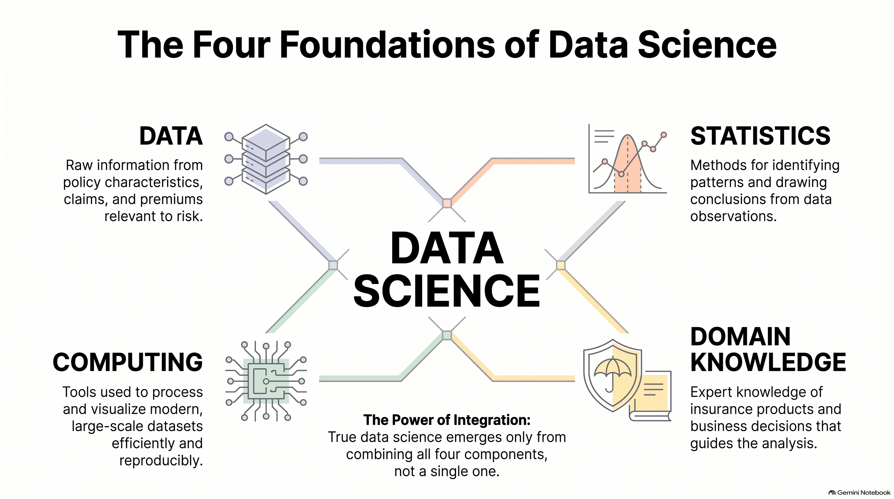
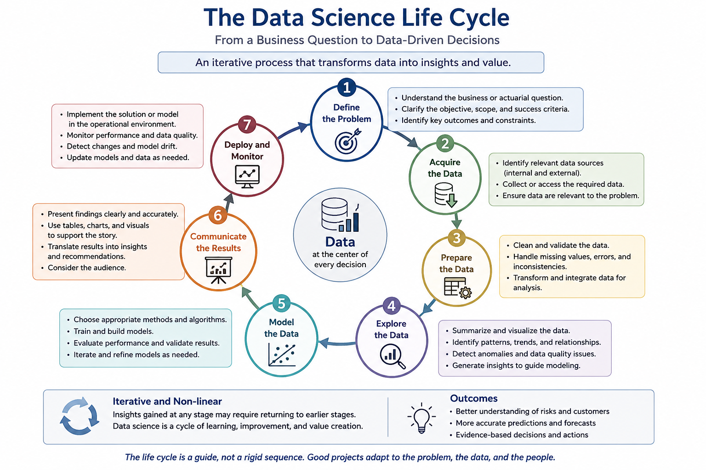
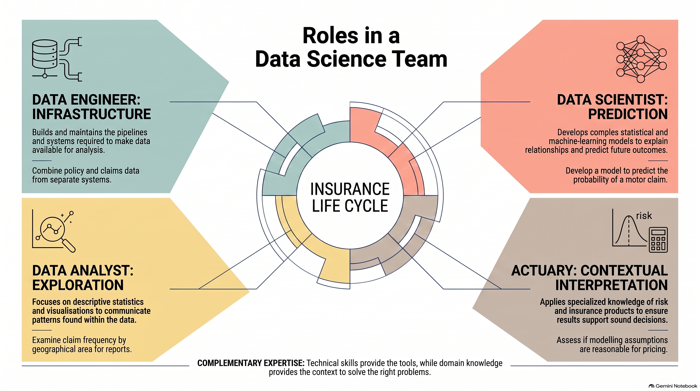
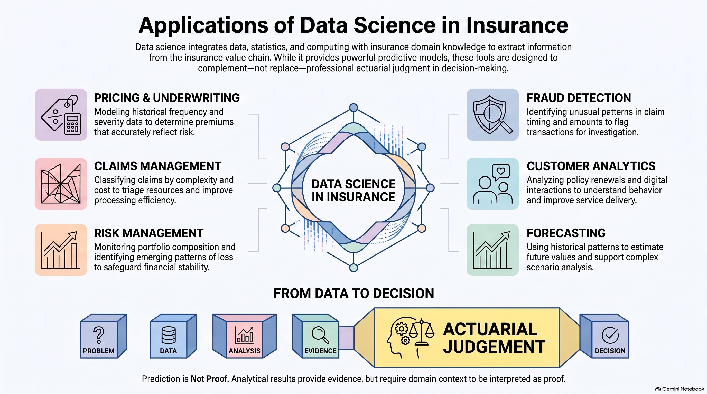

# Chapter 2: Introduction to Data Science

## Learning Outcomes {.unnumbered}

By the end of this chapter, students should be able to:

1. Explain the role of data science in supporting insurance and actuarial decision-making.
2. Describe the relationship between data, statistics, computing, and domain knowledge in data science.
3. Identify common sources and types of data used in insurance.
4. Describe the main stages of the data science life cycle and explain how they relate to insurance problems.
5. Distinguish the roles of data analysts, data scientists, data engineers, and actuaries in a data science project.
6. Identify applications of data science in insurance, including pricing, underwriting, claims management, fraud detection, customer analytics, and risk management.
7. Explain how data-driven evidence is combined with actuarial judgement to support insurance decisions.

---

## From Insurance to Data Science

Insurance is fundamentally concerned with making decisions under uncertainty. As discussed in Chapter 1, insurers pool risks, use information about past experience to assess future losses, and determine premiums that are appropriate for the risks being insured. These activities require more than an understanding of insurance principles and probability. They also require reliable data and systematic methods for analysing it.

For example, a motor insurer may want to determine whether claim frequency differs according to age, geographical area, vehicle characteristics, or other characteristics of policyholders. The insurer must obtain appropriate data, assess its quality, identify relevant patterns, and use suitable statistical methods to support the decision. These activities are part of the broader field of data science.

### Data-Driven Insurance Decisions

An insurance decision is data-driven when information from relevant data is used systematically to support the decision. Data do not replace actuarial judgement; rather, they provide evidence that can be combined with statistical methods, insurance knowledge, and professional judgement.

Data are used throughout the insurance process. For example, insurers may use data to:

* assess and classify risks during underwriting;
* estimate claim frequency and claim severity;
* determine appropriate premiums;
* monitor claims and identify unusual patterns;
* evaluate the experience of an insurance portfolio; and
* support decisions about risk management and business strategy.

Consider a motor insurance portfolio. Suppose an insurer observes that policyholders in different age groups have different claim frequencies. The insurer can examine the observed experience, investigate whether the difference is supported by sufficient data, and determine whether age should be considered when assessing risk.

The process can be viewed as:

$$
\text{Insurance problem}
\rightarrow
\text{Data}
\rightarrow
\text{Analysis}
\rightarrow
\text{Evidence}
\rightarrow
\text{Decision}.
$$

The purpose of data science is therefore not simply to produce calculations or visualisations. Its purpose is to help transform data into useful information and evidence for decision-making.

::: {.callout-note}

## Data do not speak for themselves

Observed patterns in insurance data must be interpreted in their context. A difference between two groups does not necessarily imply that the corresponding risk factor causes the difference. Data quality, exposure, other risk factors, and the method of analysis must also be considered.

:::

### From Risk to Data

Chapter 1 introduced risk as uncertainty concerning future outcomes and showed how insurance uses probability and pooling to manage this uncertainty. In practice, however, the probabilities and expected losses used by insurers are not known with certainty. They must be estimated from observations.

Suppose an insurer wants to estimate the expected number of claims for a portfolio. Historical observations may contain the number of claims and the corresponding exposure for each policy. A simple estimate of claim frequency is

$$
\widehat{\lambda}
=\frac{\text{Number of claims}}
{\text{Exposure}}.
$$

This simple calculation illustrates an important transition from the concepts of Chapter 1 to the methods introduced in this chapter. The concept of risk is theoretical, but its measurement requires data.

The same principle applies to claim severity. If observed claims have amounts $X_1,\ldots,X_n$, their average provides a basic estimate of the average claim amount:

$$
\widehat{\mu}
=\frac{1}{n}\sum_{i=1}^{n} X_i.
$$

In practice, insurers work with much richer data. A policy record may contain information about the policyholder, the insured object, geographical area, coverage, exposure period, and claims. These data can be used to investigate how insurance outcomes vary across different characteristics.

Thus, the relationship between risk and data can be represented as

$$
\boxed{
\text{Risk}
\rightarrow
\text{Observable outcomes}
\rightarrow
\text{Data}
\rightarrow
\text{Statistical analysis}
\rightarrow
\text{Risk assessment}
}.
$$

Data science provides a systematic framework for the stages involving data collection, preparation, exploration, analysis, modelling, and communication.

::: {.callout-important}

## Exposure matters in insurance data

Insurance experience cannot always be compared using raw counts alone. A portfolio with more policies or a longer period of exposure will generally produce more claims simply because it contains more opportunity for claims to occur. Measures such as claim frequency therefore relate observed claims to an appropriate measure of exposure.
:::

### Why Data Science Matters to Actuaries

Actuaries have traditionally used mathematics, probability, statistics, and financial theory to analyse uncertainty and make decisions about risk. Data science extends these capabilities by providing a broader framework for working with data throughout the analytical process.

For actuaries, data science is particularly relevant because modern insurance problems often involve large and complex datasets. An actuary may need to combine information from different sources, identify data-quality problems, explore relationships between variables, develop statistical models, and communicate the results to decision-makers.

The role of the actuary is not simply to apply an algorithm to a dataset. Actuarial knowledge is needed to formulate an appropriate problem, select meaningful variables, recognise relevant exposure measures, assess whether modelling assumptions are reasonable, and interpret the results in the context of insurance.

For example, a statistical model may indicate that claim frequency varies between two groups of policyholders. An actuary must consider whether the difference is credible, whether other risk factors may explain the observed relationship, whether the available exposure is sufficient, and whether the result is appropriate for the intended insurance decision.

This illustrates the complementary roles of data science and actuarial science:

| Data science                               | Actuarial science                               |
| ------------------------------------------ | ----------------------------------------------- |
| Collects and prepares data                 | Understands the insurance problem               |
| Explores and visualises data               | Interprets risk and uncertainty                 |
| Develops statistical and predictive models | Assesses actuarial assumptions and implications |
| Communicates analytical results            | Applies professional judgement to decisions     |

Data science should therefore be viewed as an important part of the modern actuarial toolkit. The objective is not to replace actuarial reasoning with data or algorithms, but to combine **data, statistical methods, computational tools, and actuarial judgement** to make better-informed decisions.

This chapter develops the foundations for that process. It begins with the nature of data and the data science life cycle, before introducing methods for acquiring, preparing, exploring, modelling, and communicating data.

## What Is Data Science?

Data science is concerned with extracting useful information and knowledge from data to support understanding, prediction, and decision-making. It combines statistical methods, computational tools, and knowledge of the subject area in which the data arise.

There is no single method that defines data science. Different problems require different combinations of data management, statistical analysis, programming, visualisation, and modelling. The common element is the systematic use of data to answer meaningful questions.

For an insurer, for example, data science may be used to investigate questions such as:

* How does claim frequency vary across different groups of policyholders?
* Which characteristics are associated with larger claims?
* Can future claims be predicted from available information?
* Are there unusual patterns in claims that require further investigation?

These questions require more than simply calculating statistics. They require an understanding of the insurance problem, appropriate data, suitable analytical methods, and computational tools.

### Data, Statistics, Computing and Domain Knowledge

Data science brings together four closely related components: **data, statistics, computing, and domain knowledge**.

**Data** provide the observations from which information can be obtained. In insurance, data may include policy characteristics, exposure, claims, claim amounts, premiums, and other information relevant to risk.

**Statistics** provides methods for describing data, identifying patterns, quantifying uncertainty, and drawing conclusions from observations. For example, an insurer may use statistical methods to estimate claim frequency or compare the experience of different groups.

**Computing** provides the tools needed to store, manipulate, analyse, and visualise data. Modern datasets may contain thousands or millions of observations, making computational tools essential for carrying out analyses efficiently and reproducibly.

**Domain knowledge** provides an understanding of the context in which the data arise. For an actuary, this includes knowledge of insurance products, risk, exposure, claims, premiums, and the business decisions that the analysis is intended to support.

These components are complementary:

<!-- $$ -->
<!-- \boxed{ -->
<!-- \text{Data Science} -->
<!-- =\text{Data} -->
<!-- + -->
<!-- \text{Statistics} -->
<!-- + -->
<!-- \text{Computing} -->
<!-- + -->
<!-- \text{Domain Knowledge} -->
<!-- } -->
<!-- $$ -->

{#fig-foundations fig-align="center" width=85% .lightbox}

The combination is important because weakness in any one component can affect the quality of the analysis. A sophisticated statistical model cannot compensate for poor-quality data, and a technically correct analysis may still lead to an inappropriate conclusion if the insurance context is misunderstood.

For example, suppose an insurer observes that one group of policyholders has a higher claim frequency than another. Statistics can quantify the difference, computing can process the underlying data, and domain knowledge can help determine whether the comparison is meaningful. The analysis may also need to account for exposure and other characteristics that differ between the groups.

::: {.callout-important}

## Data science is more than programming

Programming is an important tool in data science, but data science is not simply programming with data. A successful analysis requires an appropriate question, reliable data, suitable statistical methods, and an understanding of the context in which the results will be used.
:::

The four components can therefore be viewed as complementary skills rather than separate stages:

| Component        | Main purpose                         | Example in insurance                   |
| ---------------- | ------------------------------------ | -------------------------------------- |
| Data             | Provide observations                 | Policy and claims records              |
| Statistics       | Quantify and analyse patterns        | Estimate claim frequency               |
| Computing        | Process and analyse data efficiently | Use R to manipulate and model data     |
| Domain knowledge | Interpret results in context         | Understand exposure and insurance risk |

For an actuarial student, this framework is particularly useful. Actuarial training already provides a strong foundation in statistics, probability, and insurance knowledge. Data science adds computational and analytical practices that allow these foundations to be applied effectively to increasingly complex datasets.

### Data Science and Decision-Making

The ultimate purpose of data science is not to produce data, tables, graphs, or models for their own sake. Its purpose is to provide evidence that can improve decisions.

A useful way to view the process is:

$$
\text{Question}
\rightarrow
\text{Data}
\rightarrow
\text{Analysis}
\rightarrow
\text{Evidence}
\rightarrow
\text{Decision}.
$$

Consider an insurer deciding whether a particular characteristic should be used in pricing. The analysis might begin with historical policy and claims data. The data are then prepared and explored, and an appropriate statistical model may be developed. The results provide evidence about the relationship between the characteristic and insurance outcomes. The insurer can then consider whether that evidence is sufficient and appropriate for a pricing decision.

The quality of the final decision depends on more than the predictive performance of a model. The analyst must also consider the quality and relevance of the data, the assumptions underlying the analysis, uncertainty in the results, and the consequences of using those results.

This is particularly important in insurance because decisions can affect both the insurer and its policyholders. For example, a pricing model may identify differences in expected claim costs between groups. An actuarial assessment must consider whether those differences are credible, whether the data support the conclusion, and whether the resulting rating structure is appropriate for the insurance product.

Data science therefore supports, rather than replaces, professional judgement. The role of the actuary is to connect analytical evidence with insurance principles and business decisions.

::: {.callout-note}

## From analysis to action

A useful data-science result should answer three questions:

1. **What did the data show?**
2. **How reliable is the evidence?**
3. **What decision, if any, should follow from it?**

Keeping these questions in mind helps distinguish useful analysis from analysis that merely produces numerical results.
:::

The distinction between **analysis** and **decision-making** will remain important throughout this book. Data science provides methods for obtaining evidence from data; actuarial science provides the risk, financial, and professional context needed to interpret that evidence and use it responsibly.

## The Role of Data in Insurance

Data provide the empirical foundation for many insurance activities. Insurers collect and maintain information about policies, policyholders, exposures, premiums, claims, and payments. These data allow insurers to measure past experience, assess current risks, and support decisions about underwriting, pricing, claims management, and risk management.

The usefulness of insurance data depends on more than the amount of information available. Data must be relevant to the problem, recorded consistently, and sufficiently complete and accurate for the intended analysis. In addition, insurance data often need to be interpreted in relation to exposure and the characteristics of the insurance portfolio.

For example, the number of claims alone provides limited information about claim risk. A portfolio with 1,000 claims may have a higher risk than a portfolio with 500 claims, but it may simply have a much larger amount of exposure. Comparing claim frequency rather than claim counts can provide a more meaningful basis for comparison.

### Insurance Data Sources

Insurance data come from many sources. Some are generated directly through the insurer's operations, while others may be obtained from external sources.

Common internal sources include:

* **Policy data** — information about policies, such as policy type, coverage, inception and expiry dates, insured characteristics, and premium.
* **Exposure data** — information describing the amount of time or risk exposure associated with a policy.
* **Claims data** — information about reported claims, including claim dates, claim types, claim status, and claim amounts.
* **Payment data** — information about premiums received, claim payments, expenses, and other financial transactions.
* **Customer data** — information used to understand policyholder characteristics and interactions with the insurer.

External sources may provide additional information relevant to risk assessment. Examples include geographical information, demographic information, weather data, economic indicators, and other publicly or commercially available data.

These sources may be stored separately. For example, policy information and claims information may be maintained in different systems and linked using a policy identifier. Combining these sources is often an important part of an insurance data-science project.

A simple representation is:

$$
\text{Policy data}
+
\text{Exposure data}
+
\text{Claims data}
\longrightarrow
\text{Insurance analysis}.
$$

The appropriate data sources depend on the question being investigated. A pricing analysis may require policy, exposure, claim, and premium information, whereas a claims-management analysis may focus more heavily on claim and payment records.

::: {.callout-note}

## Start with the question

The objective of data collection is not to collect as much data as possible. The data should be relevant to the question being investigated and measured in a way that supports the intended analysis.

:::

### Types of Data

Insurance datasets contain variables with different characteristics. Recognising the type of each variable is important because the type determines how the variable can be summarised, visualised, and analysed.

One useful distinction is between **categorical** and **numerical** data.

**Categorical data** describe membership in a group or category. Examples include:

* type of insurance;
* geographical area;
* vehicle type;
* policy status; and
* claim type.

A categorical variable may have a small number of possible categories. For example, a policy may be classified as `Urban` or `Rural`.

**Numerical data** represent quantities for which arithmetic operations are meaningful. Examples include:

* age;
* exposure;
* premium;
* number of claims; and
* claim amount.

Numerical variables can be further distinguished as **discrete** or **continuous**.

A discrete variable takes values that can be counted. The number of claims, for example, is a discrete variable:

$$
N \in {0,1,2,\ldots}.
$$

A continuous variable can take values within an interval. Claim amount and exposure are examples, depending on how they are measured and recorded.

Another useful distinction is between **structured** and **unstructured** data. Structured data are organised in a predefined format, such as rows and columns in a database. Traditional policy and claims records are usually structured data. Unstructured data do not follow such a predefined tabular structure and may include documents, images, audio, or text.

For introductory actuarial analysis, structured data are particularly important because many insurance models are developed from datasets in which each row represents an observation and each column represents a variable.

| Variable         | Example | Type                                                  |
| ---------------- | ------- | ----------------------------------------------------- |
| Age              | 35      | Numerical, continuous/discrete depending on recording |
| Area             | Urban   | Categorical                                           |
| Exposure         | 0.75    | Numerical, continuous                                 |
| Number of claims | 2       | Numerical, discrete                                   |
| Claim amount     | 18,500  | Numerical, continuous                                 |
| Policy status    | Active  | Categorical                                           |

The classification of a variable is not merely a technical label. It affects the methods used to analyse the variable. For example, the distribution of a numerical variable may be examined using a histogram, whereas the frequencies of categories may be displayed using a bar chart.

::: {.callout-important}

## A variable's role depends on the analysis

The same variable can serve different roles in different analyses. For example, claim amount may be an outcome variable when modelling claim severity, but it may also be summarised as part of an exploratory analysis. Variable type and variable role should therefore be considered separately.
:::

### An Insurance Dataset

To illustrate the data-science process, consider a simplified motor insurance dataset. Each row represents an insurance policy, while each column records a characteristic of that policy or its observed experience.

| Policy | Age | Area  | Exposure | Claims | Claim Amount |
| -----: | --: | ----- | -------: | -----: | -----------: |
|      1 |  24 | Urban |     1.00 |      1 |       12,500 |
|      2 |  42 | Rural |     1.00 |      0 |            0 |
|      3 |  31 | Urban |     0.50 |      2 |        8,400 |
|      4 |  56 | Rural |     1.00 |      0 |            0 |
|      5 |  27 | Urban |     0.75 |      1 |       21,300 |
|      6 |  45 | Urban |     1.00 |      0 |            0 |

This small dataset contains several types of insurance information. `Age` and `Area` describe characteristics of the policyholder or risk, while `Exposure` describes the amount of risk observed during the period. `Claims` records the number of observed claims, and `Claim Amount` records the corresponding aggregate claim amount.

The dataset can be used to illustrate several questions.

**Descriptive question:**
How does claim experience vary across different areas?

**Frequency question:**
What is the observed claim frequency?

**Severity question:**
What is the average claim amount among policies with claims?

**Comparative question:**
Does claim experience appear to differ between younger and older policyholders?

These questions illustrate an important feature of insurance data: different variables describe different aspects of the risk. In particular, the distinction between **frequency** and **severity** is fundamental in insurance analysis.

For a portfolio, claim frequency can be represented by

$$
\text{Claim frequency}
=\frac{\text{Number of claims}}
{\text{Exposure}},
$$

while average claim severity can be represented by

$$
\text{Average severity}
=\frac{\text{Total claim amount}}
{\text{Number of claims}},
$$

provided that the denominator is positive.

Combining the two gives the basic relationship

$$
\text{Expected loss per unit exposure}
\approx
\text{Claim frequency}
\times
\text{Average severity}.
$$

This relationship provides a simple bridge between the insurance concepts introduced in Chapter 1 and the data-science methods introduced in this chapter. The quantities are estimated from observed data, and more advanced methods can then be used to examine how they vary with risk characteristics.

## The Data Science Life Cycle

A data science project typically follows a sequence of activities that transforms a practical problem into an evidence-based decision. Although individual projects differ, most involve several common stages:

<!-- $$ -->
<!-- \text{Define} -->
<!-- \rightarrow -->
<!-- \text{Acquire} -->
<!-- \rightarrow -->
<!-- \text{Prepare} -->
<!-- \rightarrow -->
<!-- \text{Explore} -->
<!-- \rightarrow -->
<!-- \text{Model} -->
<!-- \rightarrow -->
<!-- \text{Communicate} -->
<!-- \rightarrow -->
<!-- \text{Deploy and monitor}. -->
<!-- $$ -->

{#fig-lifecycle fig-align="center" width=80%}

These stages provide a useful framework for organising a data science project. They should not, however, be viewed as a strictly linear process. Findings from one stage may require the analyst to return to an earlier stage. For example, exploratory analysis may reveal data-quality problems that require additional data preparation, while modelling results may indicate that the original question needs to be reconsidered.

In insurance, the cycle may begin with a question about claim experience, proceed through the analysis of policy and claims data, and ultimately produce information that supports underwriting, pricing, claims management, or risk management.

### Define the Problem

The first stage is to clearly define the problem that the analysis is intended to address. A data science project should begin with a question or decision, rather than with a dataset or a particular modelling technique.

For an insurance problem, the analyst should establish:

* what decision needs to be supported;
* what outcome or quantity is of interest;
* which population or portfolio is being studied;
* what information may be relevant; and
* how the results will be used.

For example, an insurer may observe differences in motor insurance claim experience and ask:

> **Which characteristics are associated with differences in claim frequency?**

This question is more useful than simply stating that the insurer wants to "analyse the claims data." It identifies the outcome of interest and provides a direction for the analysis.

The problem should also be translated into measurable quantities. For example, if claim frequency is being studied, the analysis needs information about both the number of claims and the corresponding exposure.

::: {.callout-important}

## Start with the decision, not the model

The choice of statistical or machine-learning method should follow from the problem being addressed. A sophisticated model is not useful if it does not answer a relevant question or support a meaningful decision.

A well-defined problem provides a clear objective for the remaining stages of the data science life cycle.

:::

### Acquire the Data

Once the problem has been defined, the next stage is to obtain the data required for the analysis.

Insurance data may come from several sources, including policy administration systems, claims systems, financial records, customer databases, and external sources. Data from different systems may need to be combined using a common identifier such as a policy or claim number.

The data required depend on the question being investigated. For example, analysing claim frequency may require:

* the number of claims;
* exposure;
* policy characteristics; and
* relevant risk characteristics.

Data acquisition may involve importing files, querying databases, accessing application programming interfaces (APIs), or obtaining data from external sources.

At this stage, it is important to distinguish between **available data** and **appropriate data**. A large dataset is not necessarily useful if it does not measure the quantities relevant to the problem.

### Prepare the Data

Raw data are rarely ready for analysis. Data preparation involves checking, cleaning, transforming, and organising the data so that they are suitable for the intended analysis.

Common problems include:

* missing values;
* invalid or impossible values;
* inconsistent data types;
* duplicated observations;
* inconsistent categories;
* incorrect dates; and
* records that fall outside the relevant observation period.

Insurance data provide many examples. A policy may have a missing inception date, an exposure period may be incorrectly recorded, a claim may be associated with a policy that was not active at the claim date, or a categorical variable may contain several different labels for the same geographical area.

Data preparation may also require transformations. For example, a date may need to be converted into a standard date format, or several claim records may need to be aggregated to obtain the total claim amount for each policy.

The objective is not simply to make the dataset look tidy. Each transformation should have a clear reason based on the meaning of the underlying data and the requirements of the analysis.

::: {.callout-note}

## Data cleaning is part of the analysis

Cleaning data is not merely a technical task. Decisions about missing, invalid, or unusual observations can affect the results of the analysis. Data preparation should therefore be documented and carried out with an understanding of the underlying insurance process.
:::

### Explore the Data

After the data have been prepared, the next stage is **exploratory data analysis (EDA)**. The purpose of EDA is to understand the main characteristics of the data before formal modelling.

EDA can be used to examine:

* the distribution of individual variables;
* differences between groups;
* relationships between variables;
* unusual or extreme observations;
* missing values; and
* possible data-quality problems.

For example, an insurer may compare claim frequency across geographical areas or examine the distribution of claim amounts.

Both numerical summaries and graphical methods can be useful. Means, medians, standard deviations, and other descriptive statistics provide numerical summaries, while histograms, boxplots, bar charts, and scatterplots can reveal patterns that may not be apparent from numerical summaries alone.

EDA can also influence subsequent modelling. It may reveal variables that require transformation, groups that should be examined separately, or potential relationships that require further investigation.

Thus, exploration is not simply a preliminary presentation of the data. It helps the analyst understand what the data can reasonably support.

### Model the Data

Once the data have been understood, an appropriate statistical or computational model can be developed when modelling is required.

A model provides a mathematical representation of relationships in the data. Depending on the problem, the objective may be to explain observed patterns, estimate an unknown quantity, or predict future outcomes.

In insurance, examples include:

* modelling claim frequency;
* modelling claim severity;
* predicting the probability of a claim;
* forecasting future claims; and
* estimating expected losses.

The choice of model depends on the nature of the outcome, the available data, the purpose of the analysis, and the assumptions that can reasonably be made.

For example, the number of claims is a count variable, whereas claim amount is a monetary variable. These different outcomes may require different modelling approaches.

Model development should also include evaluation. A model that fits historical data well may not necessarily provide reliable predictions for new observations. The analyst therefore needs to assess whether the model is appropriate for its intended purpose.

::: {.callout-important}

## A model is an approximation

A statistical model does not reproduce reality exactly. It provides a simplified representation of relationships observed in the data. Its usefulness depends on whether the assumptions and results are appropriate for the problem being considered.
:::

### Communicate the Results

The results of an analysis must be communicated clearly to the people who will use them. A technically correct analysis has limited value if its findings cannot be understood or connected to the original decision.

Communication may involve:

* tables;
* charts and visualisations;
* written reports;
* presentations; or
* interactive dashboards.

The form of communication should reflect the audience. An actuarial report may require technical details about assumptions and model performance, whereas senior management may need a concise summary of the main findings and their implications.

Good communication should connect the results back to the original question. For example, rather than simply reporting that two groups have different observed claim frequencies, the analyst should explain the size of the difference, the evidence supporting it, relevant limitations, and its potential implications for the insurance decision.

A useful structure is:

$$
\text{Problem}
\rightarrow
\text{Evidence}
\rightarrow
\text{Interpretation}
\rightarrow
\text{Implication}.
$$

This helps ensure that analysis leads to understanding rather than simply producing additional information.

### Deploy and Monitor

When an analysis produces a model intended for operational use, the final stage is to deploy the model and monitor its performance.

**Deployment** means making the model available within the process for which it was developed. For example, a predictive model might be incorporated into an underwriting system to estimate risk when a new policy is quoted.

Deployment should normally be preceded by appropriate testing. The model should be checked in an environment that reflects its intended use before it is introduced into production.

Once deployed, the model should not simply be left unchanged. Insurance portfolios, customer behaviour, economic conditions, claim patterns, and data-generation processes can change over time. A model that performed well when developed may therefore become less appropriate later.

**Monitoring** involves checking whether the model and its underlying data continue to perform as expected. This may include monitoring predictive performance, data quality, unusual changes in input variables, and differences between predicted and observed outcomes.

For example, if a claim prediction model consistently underestimates the frequency of claims in a particular segment, the model may need to be investigated and potentially recalibrated or redeveloped.

::: {.callout-tip}

## The life cycle is iterative

The final stage may lead back to earlier stages. Changes in model performance may require new data, additional data preparation, further exploration, or redevelopment of the model.

$$
\boxed{
\text{Data science is a cycle, not a one-time process}
}
$$

The objective is to develop solutions that remain useful as the data, environment, and decision-making requirements change.
:::

## Roles in a Data Science Team

Data science projects often involve several people with different areas of expertise. Although the responsibilities may overlap, different roles contribute different skills to the data science life cycle.

The composition of a data science team depends on the size and nature of the organisation. In a small organisation, one person may perform several roles. In a larger organisation, responsibilities may be distributed among specialists.

Three common roles are **data analyst**, **data scientist**, and **data engineer**. In an insurance organisation, these roles may work closely with actuaries and other insurance professionals.

{#fig-team-roles fig-align="center" width=85% .lightbox aria-descr="Venn diagram or chart showing collaboration between Data Engineers, Data Scientists, and MLOps Engineers."}

### Data Analyst

A data analyst focuses on understanding and communicating information contained in data. Typical activities include:

* collecting and preparing data for analysis;
* producing descriptive statistics;
* identifying patterns and trends;
* creating tables and visualisations; and
* communicating findings to stakeholders.

For example, a data analyst in an insurance company might examine claim frequency by geographical area and prepare a report showing differences in observed experience.

The role is closely associated with the **exploration and communication** stages of the data science life cycle.

### Data Scientist

A data scientist typically works on more complex analytical and predictive problems. In addition to preparing and exploring data, a data scientist may develop statistical or machine-learning models to explain relationships or make predictions.

For example, a data scientist might develop a model to predict the probability that a motor insurance policy will generate a claim.

The role commonly involves:

* statistical modelling;
* predictive modelling;
* machine learning;
* model evaluation; and
* translating analytical results into useful information for decision-making.

The precise responsibilities vary between organisations, and the distinction between a data analyst and a data scientist is not always strict.

### Data Engineer

A data engineer focuses on the infrastructure and processes required to make data available for analysis. This may include:

* collecting data from different systems;
* building and maintaining data pipelines;
* storing and organising data;
* integrating data from multiple sources; and
* ensuring that data can be accessed reliably.

For example, an insurance company may have separate systems for policies, claims, and payments. A data engineer may develop processes that extract and combine information from these systems so that it can be used for analysis.

The work of a data engineer is particularly important in the **data acquisition and preparation** stages of the data science life cycle.

### The Actuary in a Data Science Team

For an actuarial student, an important question is where the **actuary** fits within a data science team.

Actuaries contribute specialised knowledge of risk, uncertainty, insurance products, financial consequences, and actuarial methods. They also understand the decisions that analytical results are intended to support.

For example, when developing a model for motor insurance pricing, an actuary may contribute by:

* defining the insurance problem;
* identifying appropriate measures of exposure;
* selecting relevant risk characteristics;
* assessing whether modelling assumptions are reasonable;
* interpreting model results in an insurance context; and
* considering the implications for pricing and risk management.

This illustrates the complementary nature of the different roles.

| Role           | Main focus                               | Example in insurance           |
| -------------- | ---------------------------------------- | ------------------------------ |
| Data analyst   | Describe and communicate data            | Analyse claim experience       |
| Data scientist | Develop analytical and predictive models | Predict claim frequency        |
| Data engineer  | Build and manage data infrastructure     | Combine policy and claims data |
| Actuary        | Apply risk and insurance expertise       | Interpret results for pricing  |

The boundaries between these roles are not fixed. An actuary may perform data analysis and statistical modelling, while a data scientist may need substantial knowledge of the insurance problem. In smaller organisations, a single person may perform several of these functions.

What matters is not the job title but the combination of skills required to complete the data science life cycle.

::: {.callout-note}

## Data science is collaborative

A successful data science project usually requires more than one type of expertise. Technical skills are needed to work with data and develop models, while domain knowledge is needed to ensure that the analysis addresses the right problem and that its results are interpreted appropriately.

For actuarial students, developing data-science skills therefore does not mean becoming a data engineer or replacing actuarial methods with machine learning. Instead, these skills provide additional tools for applying actuarial knowledge to increasingly complex data and decision-making problems.
:::

## Applications of Data Science in Insurance

Data science can be applied throughout the insurance value chain. Insurers collect data at many stages of the insurance process, from underwriting and policy administration to claims settlement and portfolio management. Analysing these data can help insurers understand risk, improve operational processes, and support better-informed decisions.

The applications of data science in insurance can be grouped into several broad areas:

<!-- $$ -->
<!-- \boxed{ -->
<!-- \text{Pricing} -->
<!-- \quad -->
<!-- \text{Claims} -->
<!-- \quad -->
<!-- \text{Fraud} -->
<!-- \quad -->
<!-- \text{Customers} -->
<!-- \quad -->
<!-- \text{Risk} -->
<!-- } -->
<!-- $$ -->

{#fig-insurance-apps fig-align="center" width=90% group="insurance" .lightbox}

The methods used in each area may differ, but they generally follow the same data-science principles introduced earlier in this chapter: define a problem, obtain and prepare relevant data, explore the data, develop an appropriate analysis or model, and communicate the results.

### Pricing and Underwriting

Pricing is one of the most important applications of data science in insurance. Insurers need to estimate the expected cost of claims and determine premiums that appropriately reflect the risks being insured.

Historical policy and claims data can be used to investigate how insurance outcomes vary with characteristics such as age, geographical area, vehicle characteristics, coverage, or other risk factors.

For example, a motor insurer may analyse claim experience to investigate whether claim frequency varies with the age of the policyholder. A statistical model can then be used to estimate expected claim frequency for different combinations of risk characteristics.

A simple representation is

$$
\text{Expected loss}
\approx
\text{Expected frequency}
\times
\text{Expected severity}.
$$

Data science can support both components. Historical data can be used to model the number of claims and the amount of individual claims, while other variables can be used to explain differences in risk.

Data can also support underwriting decisions. An insurer may use information available at the time a policy is requested to assess the characteristics of the risk and determine whether additional information or underwriting review is required.

::: {.callout-note}

## Data science does not replace actuarial pricing

A predictive model provides estimates based on data and modelling assumptions. Pricing decisions also require consideration of expenses, capital, reinsurance, regulatory requirements, market conditions, and professional judgement.
:::

### Claims Management

Claims generate a substantial amount of information that can be analysed to improve the claims process.

Data science can be used to understand claim patterns, estimate expected claim costs, predict claims outcomes, and support claims triage. For example, claims may be classified according to characteristics such as type, estimated cost, complexity, or likelihood of requiring further investigation.

Predictive models can help identify claims that are likely to become large or require additional attention. This can allow claims staff to allocate resources more effectively.

Data can also be used to monitor the development of claims over time. Comparing observed claim experience with previous experience or expected outcomes can provide information for claims management and portfolio monitoring.

The objective is not necessarily to automate the entire claims process. Instead, analytical results can provide additional information to claims professionals when making decisions.

### Fraud Detection

Insurance fraud can result in financial losses and can affect the overall cost of insurance. Data science can assist insurers in identifying claims or transactions that have unusual characteristics.

For example, an insurer may analyse relationships among:

* policy characteristics;
* claim characteristics;
* claim timing;
* claim amounts; and
* previous claims.

Statistical or machine-learning methods can be used to identify patterns associated with claims that require further investigation.

An important distinction is that a model identifying an unusual claim does **not** establish that fraud has occurred. It identifies a case that may deserve additional investigation.

::: {.callout-important}

## Prediction is not proof

A data-science model can identify patterns or assign a probability to an outcome, but the result should not automatically be interpreted as evidence that a particular policyholder has committed fraud.
:::

This distinction illustrates the importance of combining analytical results with domain knowledge and appropriate professional procedures.

### Customer Analytics

Data science can also be used to understand customer behaviour and interactions with insurers.

Examples include analysing:

* policy renewals;
* cancellations and lapses;
* customer enquiries;
* product preferences; and
* patterns of interaction with digital services.

For example, an insurer may wish to identify policies that have a high probability of not being renewed. Historical policy data can be used to develop a predictive model and identify characteristics associated with higher lapse rates.

The resulting information can support decisions about customer communication, product design, and service delivery.

Customer analytics therefore extends the use of insurance data beyond the traditional assessment of claims risk. It considers how policyholders interact with the insurer and how these behaviours may affect the business.

### Risk Management and Forecasting

Data science can support broader risk-management and forecasting activities.

Insurers need to monitor changes in their portfolios and anticipate future outcomes. Historical data can be analysed to identify trends, changes in risk characteristics, and unusual patterns.

Examples include:

* forecasting claim volumes;
* monitoring changes in claim severity;
* analysing portfolio composition;
* identifying emerging patterns of loss; and
* supporting scenario analysis.

Forecasting methods can be used to estimate future values based on historical patterns and other relevant information. However, forecasts are subject to uncertainty, particularly when future conditions differ from those observed in the historical data.

For example, changes in economic conditions, technology, regulation, customer behaviour, or the underlying risk environment may affect future insurance experience.

### From Data to Insurance Decisions

The applications described above illustrate that data science is not a single insurance technique. It is a collection of methods that can support different types of insurance decisions.

The common process can be represented as:

$$
\text{Insurance problem}
\rightarrow
\text{Relevant data}
\rightarrow
\text{Analysis or model}
\rightarrow
\text{Evidence}
\rightarrow
\text{Actuarial judgement}
\rightarrow
\text{Decision}.
$$

For example, in pricing, data may provide evidence about differences in expected claims between groups of policyholders. In claims management, data may help identify claims requiring additional attention. In fraud detection, data may identify unusual patterns for investigation.

In each case, the analytical result is only one part of the decision-making process. The result must be interpreted in the context of the insurance problem, the quality of the data, the assumptions of the analysis, and the consequences of the decision.

This is why data science and actuarial science are complementary. Data science provides methods for extracting information from data, while actuarial knowledge provides the context needed to interpret that information and apply it to insurance decisions.

::: {.callout-tip}

## The same data-science principles apply across applications

Although pricing, claims, fraud detection, and customer analytics address different problems, they follow the same fundamental process:

$$
\text{Question}
\rightarrow
\text{Data}
\rightarrow
\text{Analysis}
\rightarrow
\text{Evidence}
\rightarrow
\text{Decision}.
$$

Learning the data-science process therefore provides a foundation for many different actuarial applications.
:::

